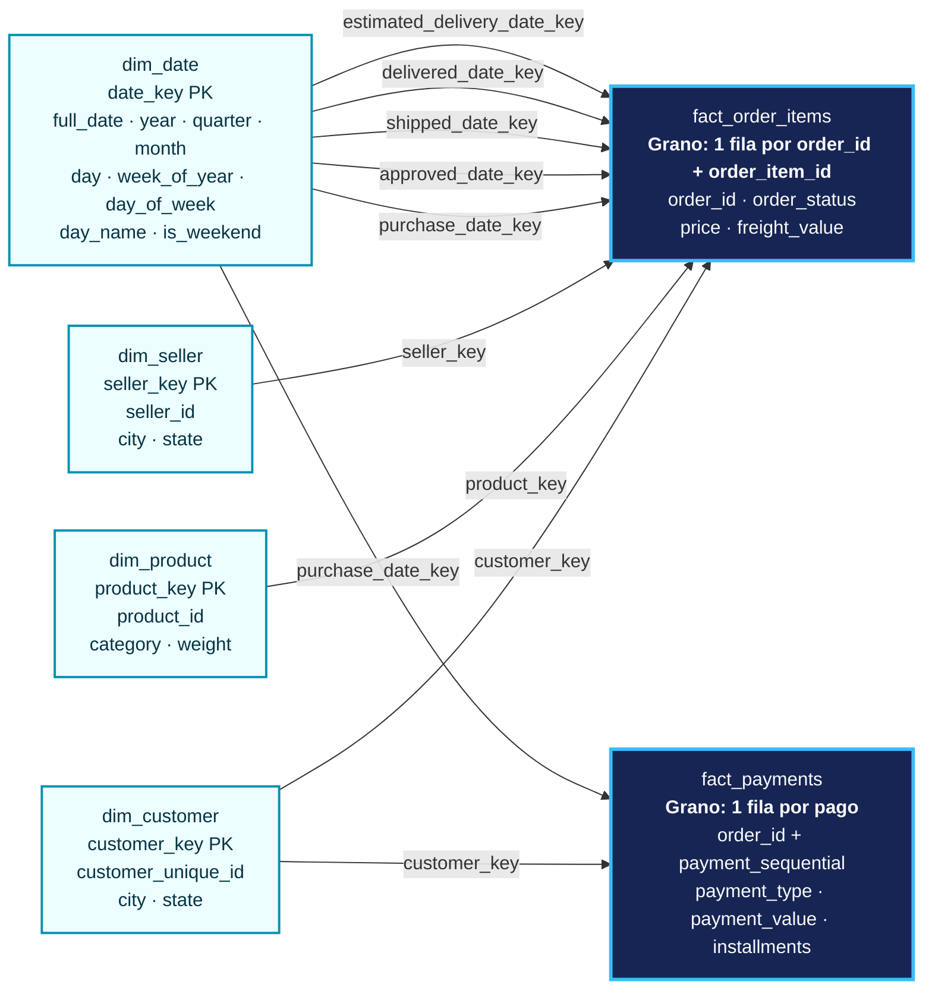
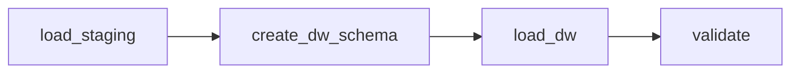
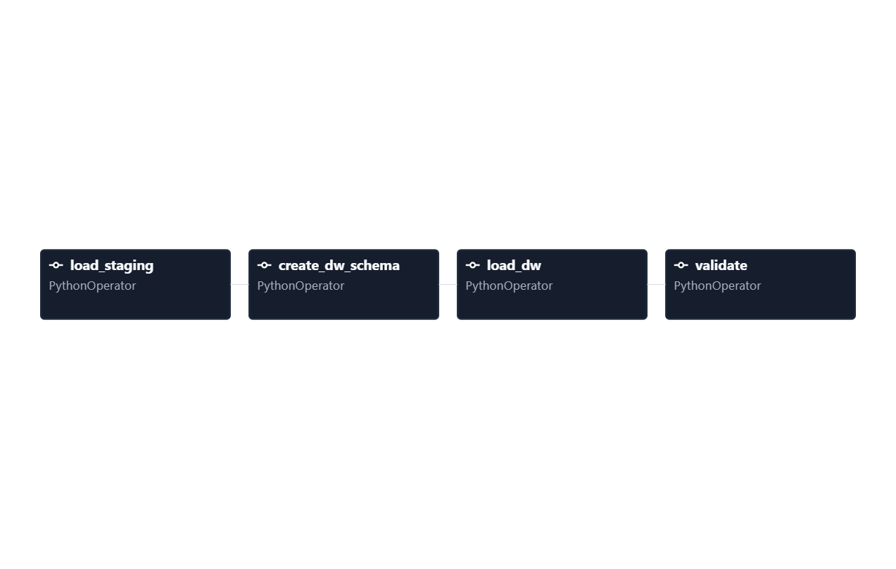
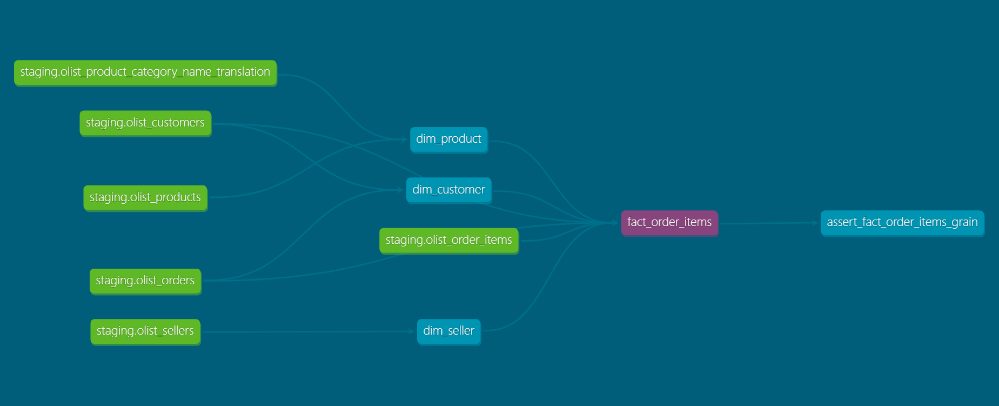
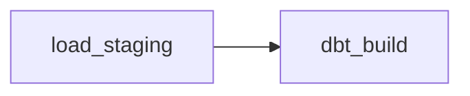
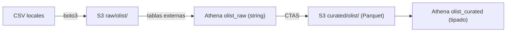

# Olist: modelo dimensional de e-commerce

Proyecto de ingeniería de datos construido sobre el **Brazilian E-Commerce Public Dataset by Olist**. Los CSV se cargan primero tal como llegan a `staging`; después, estos scripts construyen un data warehouse analítico en el esquema `dw`. El flujo está orquestado con **Apache Airflow** sobre Docker, el modelo dimensional también está implementado con **dbt** (modelos, tests y linaje), y reconstruido en **AWS** como un data lake en Parquet (S3 + Athena + dbt-athena), orquestado desde Airflow.

## Contexto

El dataset contiene pedidos realizados entre 2016 y 2018, con sus clientes, ítems, productos, vendedores, pagos y reseñas. El objetivo es responder preguntas de ventas y entregas sin mezclar tablas con granos incompatibles.

## Modelo estrella



`order_id` es una dimensión degenerada. `order_status` es un atributo de baja cardinalidad que se mantiene en la fact por simplicidad; en un modelo mayor podría extraerse a `dim_order_status`. `dim_date` es una dimensión *role-playing*: la misma tabla se relaciona con cinco significados distintos de fecha.

## Decisiones de modelado

- **Grano de `fact_order_items`:** una fila por `(order_id, order_item_id)`. Por eso las ventas se suman de forma segura desde `price` y `freight_value`.
- **Cliente:** `dim_customer` usa `customer_unique_id`, con una fila por persona. Se aplica SCD tipo 1: la ubicación del pedido más reciente reemplaza las anteriores. Solo 122 de 96.096 personas (0,13 %) aparecen con más de una ciudad, y Olist no ofrece un timestamp de cambio de dirección, así que no es posible construir un SCD tipo 2 confiable sin una regla adicional.
- **Nulos y traducciones:** productos sin categoría, peso o traducción se conservan; las categorías y traducciones faltantes se etiquetan como `unknown`. Dos categorías sin traducción tienen mapeos explícitos en la carga.
- **Pagos:** `fact_payments` se construye como una fact separada porque un pedido puede tener más de un pago (hasta 29). Unir pagos e ítems directamente produciría fan-out e inflaría las ventas.
- **Ventas:** las consultas de ventas excluyen los estados `canceled` y `unavailable`.
- **Ventas mensuales:** se usa un calendario completo y solo meses completos (enero de 2017 a agosto de 2018). Esto evita comparar diciembre con octubre cuando faltan meses en la fuente.

## Requisitos previos

- Windows con PowerShell 7+ o Linux/macOS con una terminal compatible.
- Python 3.10+ y Docker Desktop (o Docker Engine + Compose), con al menos 4 GB de RAM asignados a Docker.
- El [dataset Brazilian E-Commerce Public Dataset by Olist](https://www.kaggle.com/datasets/olistbr/brazilian-ecommerce), descargado y descomprimido en `data/olist/`.

El dataset se publica bajo licencia **CC BY-NC-SA 4.0**. Consulta los términos y la atribución en su página de Kaggle antes de reutilizarlo fuera de un contexto de aprendizaje.

## Orquestación con Airflow

El pipeline completo se ejecuta como un DAG de Airflow (`LocalExecutor`, Airflow 3). Un único `docker-compose.yml` levanta el warehouse (`db`), la base de metadatos de Airflow (`postgres`, separada del warehouse) y los servicios `airflow-apiserver`, `airflow-scheduler` y `airflow-dag-processor`.



| Tarea | Qué hace |
|---|---|
| `load_staging` | Carga los 9 CSV a `staging` (`src/load_olist.py`) |
| `create_dw_schema` | Ejecuta `sql/01_dw_ddl.sql` (puede repetirse sin error) |
| `load_dw` | Ejecuta `sql/02_dw_load.sql` (`TRUNCATE` + `INSERT`, idempotente) |
| `validate` | Ejecuta `sql/03_validations.sql`; falla si el grano o la reconciliación no cuadran |

Decisiones:

- **`schedule=None`:** Olist es un dataset estático, así que el DAG se lanza manualmente.
- **`validate` con `retries=0`:** si los datos no cuadran, reintentar no los arregla. Las demás tareas reintentan 2 veces.
- **Una transacción por archivo SQL:** `src/run_sql.py` ejecuta cada script con `psycopg2` en una sola transacción; un fallo hace rollback y no deja el DW a medias. Equivale a `psql -v ON_ERROR_STOP=1`, que no está disponible dentro del contenedor.
- **Configuración fuera del código:** la conexión (`DB_URL`) y las rutas se leen de variables de entorno definidas en el compose, por lo que los mismos scripts funcionan en local y en Airflow.

Cómo levantarlo:

```powershell
mkdir dags, logs, config, plugins

$key = python -c "import base64,os; print(base64.urlsafe_b64encode(os.urandom(32)).decode())"
$aws = ("$HOME/.aws").Replace('\','/')
@"
AIRFLOW_UID=50000
FERNET_KEY=$key
AWS_DIR=$aws
S3_BUCKET=<tu-bucket>
"@ | Set-Content .env

docker compose build
docker compose up airflow-init
docker compose up -d
```

`AWS_DIR` y `S3_BUCKET` solo se usan en los DAGs de AWS, pero el compose los lee al arrancar: la carpeta `~/.aws` debe existir (se crea con `aws login`). `.env` está en `.gitignore`; el repo incluye `.env.example` con los nombres de las variables.

Abre `http://localhost:8080` (usuario y contraseña de desarrollo: `airflow` / `airflow`), activa `olist_pipeline` y lánzalo con **Trigger**.



Para comprobar que la validación detiene el pipeline, borra una fila de `dw.fact_payments`, limpia la tarea `validate` y verás que falla; al limpiar `load_dw` con *downstream*, el DW se reconstruye y `validate` pasa.

> No uses `docker compose down -v`: el `-v` borra los volúmenes, incluido el del warehouse.

### Pipeline del clima

El DAG `weather_pipeline` (`extract_weather` → `transform_load_weather`) consume la API de Open-Meteo para Lima, guarda el JSON crudo y lo carga a `staging.weather_hourly` con linaje (`_source_file`, `_loaded_at`). `staging` conserva cada carga, y la vista `dw.weather_hourly_latest` deja la más reciente por hora con `ROW_NUMBER()`.

## Transformaciones con dbt

El mismo modelo dimensional está reimplementado con **dbt Core 1.12** y `dbt-postgres` en `dbt/olist_dw/`. dbt construye en el esquema `dbt_dev`, al lado del `dw` hecho con scripts, para poder reconciliar ambos sin riesgo. Las tablas de `staging` entran como *sources* y los modelos se encadenan con `ref()`, de modo que dbt deduce el orden de ejecución.

| Modelo | Filas | Notas |
|---|---:|---|
| `dim_date` | 1.461 | Generada con `generate_series`, sin depender de staging |
| `dim_seller` | 3.095 | |
| `dim_product` | 32.951 | Traducción de categorías, `unknown` y dos mapeos manuales |
| `dim_customer` | 96.096 | Una fila por persona; ubicación del pedido más reciente (SCD tipo 1) |
| `fact_order_items` | 112.650 | Grano `(order_id, order_item_id)`; cinco fechas *role-playing*; suma de `price` = 13.591.643,70 |
| `fact_payments` | 103.886 | Grano `(order_id, payment_sequential)`; suma de `payment_value` = 16.008.872,12 |

Ambas facts coinciden con staging en número de filas y en suma de la medida.

**Tests (36):** `unique` y `not_null` en claves; `relationships` entre las facts y las dimensiones; y tests singulares: ninguna categoría real sin traducir y grano único en ambas facts. Un macro propio (`date_key`) convierte las fechas a `YYYYMMDD` y evita repetir la expresión.

**Reconciliación:** contra el `dw` hecho con scripts, la comparación de contenido con `EXCEPT` en ambos sentidos (sin incluir las claves sustitutas, que difieren) devolvió 0 filas para `dim_customer` (incluidas las 122 personas con varias ciudades), `dim_seller`, `dim_product` y `fact_order_items`. `dim_date` y `fact_payments` coinciden en número de filas, y `fact_payments` también en la suma de `payment_value`.

```powershell
cd dbt/olist_dw
$env:DBT_PROFILES_DIR = "."
dbt build                      # modelos + tests, en orden de dependencias
dbt docs generate
dbt docs serve --port 8081     # documentación y grafo de linaje
```



### dbt dentro de Airflow

El DAG `olist_dbt_pipeline` ejecuta la carga a staging y después `dbt build`:



- dbt está instalado en un **entorno virtual propio** dentro de la imagen de Airflow (`/opt/airflow/dbt_venv`), con las versiones fijadas, para que sus dependencias no choquen con las de Airflow.
- La conexión usa `DBT_HOST=db` (el servicio del warehouse en la red de Docker); `profiles.yml` lee esa variable.
- `--target-path` y `--log-path` apuntan a `/tmp`, para no escribir artefactos en la carpeta montada desde el host.
- `dbt_build` tiene `retries=0`: dbt termina con código distinto de cero si falla un modelo o un test, y la tarea queda en rojo.
- Verificado: 6 modelos y 36 tests, `PASS=42 ERROR=0`.

## Data lake en AWS (S3 + Athena)

El mismo dataset se lleva a AWS como un data lake por capas, con una cuenta del plan gratuito de AWS (región asignada: `us-east-2`).



| Script | Qué hace |
|---|---|
| `src/upload_olist_to_s3.py` | Sube los 9 CSV a `raw/olist/<tabla>/` y verifica el tamaño de cada objeto |
| `src/create_athena_tables.py` | Crea la base `olist_raw` y una tabla externa por CSV (todo `string`, como la capa raw) |
| `src/ctas_parquet.py` | `CREATE TABLE AS SELECT` a Parquet tipado: `order_items` sin particionar y `orders` particionada por mes |

**CSV frente a Parquet** (mismos resultados, bytes escaneados por Athena):

| Consulta | CSV | Parquet | Reducción |
|---|---:|---:|---:|
| Suma de `price` en `order_items` (112.650 filas; 13.591.643,70) | 15.438.671 | 307.076 | ~50× |
| `COUNT(DISTINCT customer_id)` de pedidos de noviembre de 2017 (7.544) | 17.654.914 | 245.941 | ~72× |

Parquet guarda los datos por columnas, así que una consulta lee solo las que usa, y la partición por mes permite saltarse las carpetas que no se filtran. Un `COUNT(*)` sobre una partición de Parquet escanea 0 bytes porque se resuelve con los metadatos del archivo; por eso la segunda comparación usa una columna real. La suma de `price` coincide con la del warehouse en Postgres.

Notas de operación:

- **Región asignada:** los proyectos del plan gratuito reciben una región según el país de contacto (para Perú, `us-east-2`). En `us-east-1` y `us-west-2` las políticas del proyecto bloquean crear recursos regionales, por ejemplo un bucket de S3.
- **Credenciales temporales:** se obtienen con `aws login` y caducan; hay que iniciar sesión al empezar cada jornada. `boto3` necesita `botocore[crt]` para usarlas.
- **Parquet y tipos:** la capa `curated` convierte las cadenas vacías en `NULL` (`TRY_CAST(NULLIF(col, ''))`) y usa `decimal(10,2)` para importes.

## Modelo dimensional en AWS: dbt + Athena sobre S3/Parquet

El mismo modelo estrella que corre en Postgres (`dbt/olist_dw`) está reconstruido sobre un data lake en AWS (`dbt/olist_athena`): los CSV viven en S3, Athena los consulta con SQL y dbt construye las dimensiones y los hechos como tablas Parquet.

```
CSV (Olist) ──► S3 raw/olist/<tabla>/ ──► Athena olist_raw (tablas externas, todo string)
                                                   │
                                                   ▼ dbt-athena (CTAS a Parquet)
                                          olist_dbt: 5 dimensiones + 2 hechos
```

### Capas

| Capa | Dónde | Formato | Cómo se crea |
|---|---|---|---|
| Raw | `s3://<bucket>/raw/olist/<tabla>/` | CSV | `src/upload_olist_to_s3.py` |
| Tablas externas | Athena `olist_raw` | CSV (OpenCSVSerde, columnas string) | `src/create_athena_tables.py` |
| Curated (prueba de concepto) | Athena `olist_curated` | Parquet + Snappy, tipado, `orders` particionada por mes | `src/ctas_parquet.py` |
| Modelo dimensional | Athena `olist_dbt` | Parquet | `dbt build` en `dbt/olist_athena` |

### Reconciliación con el warehouse de Postgres

Los resultados del modelo en Athena coinciden con el modelo en Postgres:

| Medida | Postgres (`dw`) | Athena (`olist_dbt`) |
|---|---|---|
| `dim_seller` | 3,095 | 3,095 |
| `dim_product` | 32,951 | 32,951 |
| `dim_customer` | 96,096 | 96,096 |
| `dim_date` | 1,461 | 1,461 |
| `fact_order_items` filas | 112,650 | 112,650 |
| `SUM(price)` | 13,591,643.70 | 13,591,643.70 |
| `fact_payments` filas | 103,886 | 103,886 |
| `SUM(payment_value)` | 16,008,872.12 | 16,008,872.12 |

`dim_product` además coincide en 74 categorías y peso total 75,007,492.

`dbt build` ejecuta 6 modelos y 33 pruebas (unicidad, no nulos, integridad referencial hacia las dimensiones y grano de cada hecho): todas en `PASS`.

### Diferencias entre Postgres y Athena (Trino)

El SQL no es portable tal cual. Lo que hubo que cambiar:

| Postgres | Athena (Trino) |
|---|---|
| `x::int`, `x::numeric(10,2)` | `CAST(x AS integer)`, `CAST(x AS decimal(10,2))` |
| `generate_series(a, b, '1 day')` | `UNNEST(sequence(a, b, INTERVAL '1' DAY))` + `CAST(... AS date)` |
| `to_char(d, 'YYYYMMDD')` | `date_format(d, '%Y%m%d')` |
| `EXTRACT(isodow FROM d)` | `day_of_week(d)` |
| `trim(to_char(d, 'Day'))` | `date_format(d, '%W')` |
| `serial` (clave sustituta) | `ROW_NUMBER() OVER (ORDER BY clave_de_negocio)` |
| campos vacíos = `NULL` | `OpenCSVSerde` devuelve `''`: `NULLIF(col, '')` antes de castear |

Dos detalles que costaron un error:
- `sequence()` con intervalos de días devuelve timestamps; sin el `CAST(... AS date)` el CTAS a Parquet falla por precisión.
- Las tablas raw son todo `string` a propósito: la tipificación ocurre en los modelos de dbt, no al ingerir.

### Cómo reproducirlo

Requisitos: AWS CLI ≥ 2.32 (`aws login`), Python 3.12 (dbt-athena depende de paquetes sin wheel en 3.13 para Windows).

```powershell
python -m venv .venv-athena
.\.venv-athena\Scripts\Activate.ps1
pip install dbt-core dbt-athena boto3 "botocore[crt]"

aws login --profile de-journey          # credenciales temporales (12 h)
$env:S3_BUCKET = "<tu-bucket>"
$env:AWS_PROFILE = "de-journey"

python src/upload_olist_to_s3.py        # CSV -> S3
python src/create_athena_tables.py      # tablas externas olist_raw
python src/ctas_parquet.py              # (opcional) comparación CSV vs Parquet

cd dbt\olist_athena
$env:DBT_PROFILES_DIR = "."
dbt debug
dbt build
```

Las credenciales no están en el repo: `aws login` las guarda en `~/.aws`, y `profiles.yml` solo referencia el nombre del perfil y el bucket por variable de entorno.

### Costos y limpieza

- Cuenta con plan Free (créditos); Athena cobra por bytes escaneados (el dataset completo son ~120 MiB, así que cada consulta cuesta centavos o menos).
- Todo es reproducible desde este repo. Para limpiar, `python src/cleanup_aws.py` (simulación por defecto; `--execute` para borrar).

## Orquestación en AWS con Airflow

El DAG `olist_aws_pipeline` ejecuta de punta a punta el flujo del data lake: sube los CSV a S3, crea las tablas externas en Athena, construye el modelo dimensional con dbt-athena y valida las cifras.

```
upload_to_s3 ─► create_athena_tables ─► dbt_build ─► validate
```

| Tarea | Qué hace |
|---|---|
| `upload_to_s3` | Sube los 9 CSV a `s3://<bucket>/raw/olist/<tabla>/` y verifica el tamaño de cada objeto |
| `create_athena_tables` | Crea la base `olist_raw` y una tabla externa por CSV (idempotente: `IF NOT EXISTS`) |
| `dbt_build` | `dbt build` sobre `dbt/olist_athena`: 6 modelos y 33 tests, sin reintentos |
| `validate` | Consulta Athena y compara con las cifras verificadas contra Postgres (112,650 filas con `SUM(price)` = 13,591,643.70; 103,886 pagos con suma 16,008,872.12) |

### Credenciales

El contenedor de Airflow no guarda claves de AWS. Se monta, desde la máquina local, solo lo necesario de `~/.aws`:

- `config`, en solo lectura (perfil `de-journey`).
- `login/`, con escritura: boto3 renueva ahí las credenciales temporales de `aws login`.

La carpeta `credentials` (claves estáticas) no se monta. La ruta se define en `.env` (`AWS_DIR`) y el bucket en `S3_BUCKET`; ambos quedan fuera del repo, que solo incluye `.env.example`.

Las credenciales de `aws login` caducan (12 h, renovables), por eso el DAG se dispara a mano (`schedule=None`). Si una tarea falla por credenciales expiradas:

```powershell
aws login --profile de-journey
```

y se usa **Clear** sobre la tarea fallida en la UI de Airflow.

### Imagen de Docker

dbt corre en un entorno virtual separado dentro de la imagen (`/opt/airflow/dbt_venv`) con `dbt-core`, `dbt-postgres` y `dbt-athena`. `dbt-athena` depende de `mmh3`, que se compila desde el código fuente, así que la imagen instala `gcc` y `g++`.

### Limpieza de recursos

`src/cleanup_aws.py` borra las bases de Athena/Glue y los objetos del bucket. Por defecto solo simula; para borrar de verdad hay que pasar `--execute` y escribir el nombre del bucket. Todo se reconstruye volviendo a disparar el DAG.

## Ejecución manual (sin Airflow)

Con los CSV de Olist en `data/olist/`:

```powershell
# 1. Instala dependencias, inicia el warehouse y carga los CSV a staging
pip install -r requirements.txt
docker compose up -d db
python src/load_olist.py

# 2. Construye el warehouse y valida
Get-Content -Raw sql/01_dw_ddl.sql | docker compose exec -T db psql -v ON_ERROR_STOP=1 -U de -d warehouse
Get-Content -Raw sql/02_dw_load.sql | docker compose exec -T db psql -v ON_ERROR_STOP=1 -U de -d warehouse
Get-Content -Raw sql/03_validations.sql | docker compose exec -T db psql -v ON_ERROR_STOP=1 -U de -d warehouse

# 3. Ejecuta los ejemplos analíticos
Get-Content -Raw sql/04_business_queries.sql | docker compose exec -T db psql -U de -d warehouse
```

Los comandos anteriores son para **Windows/PowerShell**. En Linux/macOS usa, para cada script:

```bash
docker compose exec -T db psql -v ON_ERROR_STOP=1 -U de -d warehouse < sql/01_dw_ddl.sql
```

Repite el comando cambiando el archivo por `02_dw_load.sql`, `03_validations.sql` y `04_business_queries.sql`, en ese orden.

La bandera `-v ON_ERROR_STOP=1` hace que `psql` se detenga en el primer error y devuelva un código de salida distinto de cero. Sin ella, una validación fallida imprime el error pero el proceso termina como exitoso.

## Validaciones

`sql/03_validations.sql` se ejecuta tras cada carga. Un bloque `DO` falla con `RAISE EXCEPTION` si:

- `order_id` no es único en `olist_orders`.
- `(order_id, order_item_id)` no es único en `olist_order_items`.
- El número de filas o la suma de `price` de `fact_order_items` no coincide con staging.
- El número de filas de `fact_payments` no coincide con staging.

Después muestra conteos informativos (clientes con ubicación múltiple, productos sin categoría o traducción, pedidos con varios pagos) y reconciliaciones de grano de ambas facts. El detalle para inspección manual (por ejemplo, la lista de los 122 clientes con varias ciudades) está en `sql/exploration.sql` y no forma parte del pipeline.

## Consultas de negocio, hallazgos y límites

Las consultas ejecutables están en `sql/04_business_queries.sql`.

1. **Ventas por mes y variación mensual.** Usa una serie de meses completa y `LAG()` para comparar meses consecutivos. Los meses sin ventas aparecen como cero; la variación porcentual es `NULL` si el mes anterior fue cero. Las ventas excluyen pedidos cancelados y no disponibles, pero no equivalen necesariamente a ingresos contables reconocidos.
2. **Top 5 categorías por año.** Usa `DENSE_RANK()` sobre ventas de ítems, excluyendo también `canceled` y `unavailable`. Puede devolver más de cinco categorías si hay empate en el quinto puesto.
3. **Pedidos entregados después de la fecha estimada.** Primero reduce la fact a una fila por pedido; así evita contar varias veces pedidos con varios ítems. Solo considera pedidos con ambas fechas disponibles (es decir, ya entregados) y compara fechas, no horas.

## Resultados

Con la versión pública del dataset cargada en este proyecto, la reconciliación devuelve:

| Métrica | Staging | Data warehouse |
|---|---:|---:|
| Filas de ítems | 112.650 | 112.650 |
| Suma de `price` | 13.591.643,70 | 13.591.643,70 |
| Filas de pagos | 103.886 | 103.886 |

Hallazgos principales:

- El pico de ventas fue **noviembre de 2017**, con **1.003.862,14** en `price`, después de excluir pedidos `canceled` y `unavailable`.
- El **6,77 %** de los pedidos con ambas fechas disponibles (6.535 de 96.476) se entregó después de la fecha estimada.
- **`bed_bath_table`** lideró 2017 con **497.970,94**; **`health_beauty`** lideró 2018 con **770.002,81**. La consulta usa `DENSE_RANK()` para conservar empates.
- La fuente tiene 2.961 pedidos con pagos múltiples, por lo que pagos e ítems no deben unirse directamente.

## Limitaciones y próximos pasos

- `dim_customer` usa SCD tipo 1: la fuente no proporciona la fecha real de cambio de dirección para construir un SCD tipo 2 fiable.
- Los extremos del dataset son parciales: 2016 y septiembre de 2018 contienen pocos datos. Por eso el análisis mensual se limita de enero de 2017 a agosto de 2018.
- La puntualidad compara días (`YYYYMMDD`), no horas; un pedido entregado el mismo día de la estimación no se considera tardío.
- `fact_payments` ya está modelada como fact separada. Una `fact_reviews` queda como trabajo futuro, con su propio grano para evitar fan-out.
- En el pipeline del clima, los archivos crudos se nombran con la hora de ejecución y no con la fecha lógica del DAG, por lo que dos ejecuciones generan dos archivos. La vista `weather_hourly_latest` lo compensa; lo ideal es nombrarlos con `{{ ds }}`.
- Las claves sustitutas de dbt se generan con `ROW_NUMBER()`, por lo que pueden cambiar si llegan filas nuevas; en producción convendría una clave estable derivada del id de negocio (por ejemplo, un hash).
- `olist_aws_pipeline` se dispara a mano porque las credenciales de `aws login` caducan. En un entorno real el servicio usaría un rol de IAM asignado (sin `aws login`) y podría tener horario.
- `dbt/olist_athena` tiene 33 tests frente a 36 en `dbt/olist_dw`: por ejemplo, el test singular de categorías sin traducir no se portó.
- dbt construye en `dbt_dev` y el `dw` sigue construyéndose con scripts: ambos conviven para poder reconciliarlos. Siguiente ciclo: un perfil `prod` que apunte a `dw`, retirar el flujo con scripts SQL y añadir una `fact_reviews` con su propio grano.

## Estructura

```text
dags/
  olist_pipeline.py             # DAG: staging -> dw -> validaciones
  olist_dbt_pipeline.py         # DAG: staging -> dbt build
  olist_aws_pipeline.py         # DAG: S3 -> Athena -> dbt-athena -> validación
  weather_pipeline.py           # DAG: API de clima -> staging
sql/
  01_dw_ddl.sql                 # esquema, dimensiones y hechos
  02_dw_load.sql                # carga idempotente desde staging (TRUNCATE + INSERT)
  03_validations.sql            # controles pasa/falla y reconciliaciones
  04_business_queries.sql       # consultas de negocio
  exploration.sql               # detalle para inspección manual
src/
  load_olist.py                 # CSV -> staging
  run_sql.py                    # ejecuta archivos .sql (usado por Airflow)
  extract_weather.py            # API de clima -> JSON crudo
  transform_load_weather.py     # JSON -> pandas -> staging
  upload_olist_to_s3.py         # CSV -> S3 (capa raw)
  create_athena_tables.py       # tablas externas en Athena sobre raw
  ctas_parquet.py               # CTAS a Parquet (capa curated)
  cleanup_aws.py                # limpia bases de Athena y objetos de S3 (simulación por defecto)
docs/
  data-model.md                 # referencia del modelo y sus granos
dbt/olist_dw/
  models/                       # sources.yml, dimensiones, facts y schema.yml (tests)
  macros/                       # date_key: fecha -> YYYYMMDD
  tests/                        # tests singulares (categorías, grano)
  dbt_project.yml
  profiles.yml                  # conexión de desarrollo (esquema dbt_dev)
dbt/olist_athena/
  models/                       # sources.yml, dimensiones, facts y schema.yml sobre Athena
  macros/                       # date_key en sintaxis Trino
  tests/                        # grano de ambas facts
  dbt_project.yml
  profiles.yml                  # conexión a Athena (perfil y bucket por variables de entorno)
docker-compose.yml              # warehouse + Airflow (monta ~/.aws para los DAGs de AWS)
Dockerfile                      # imagen de Airflow con pandas y dbt (postgres + athena, venv aparte)
.env.example                    # nombres de las variables de entorno (sin valores)
requirements.txt                # dependencias locales
requirements-airflow.txt        # dependencias dentro de Airflow
```